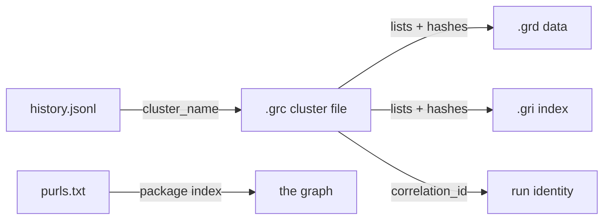
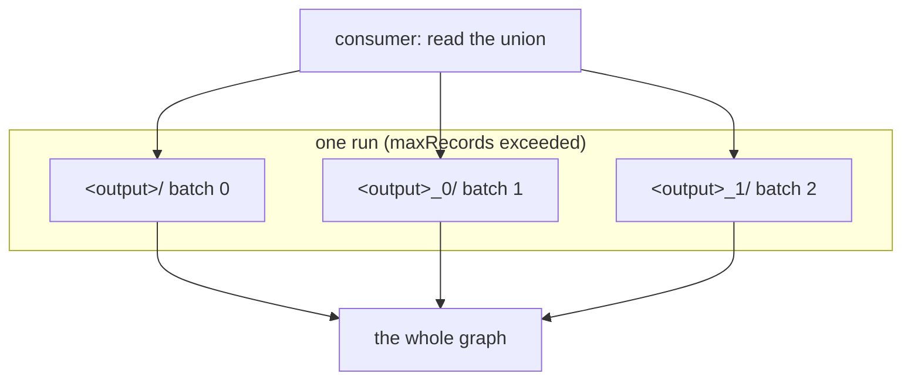

# Run Outputs — What a Survey Writes and What You May Rely On

A Goat Rodeo run writes a small, fixed set of files. This document describes
them, their naming rules, and — importantly — what happens when a run is large
enough to be split into batches, because that is where consumers most often read
the wrong directory.

Everything here is verified by tests that run a real build and read the files
back the way a consumer would. Each claim names its test.

## The output set

One run writes, into its output directory:

| File | What it is |
|---|---|
| `<hash>.grd` | Goat Rodeo Database — the CBOR-encoded items |
| `<hash>.gri` | Goat Rodeo Index — MD5 key → file offset into a `.grd` |
| `<timestamp>_<hash>.grc` | Goat Rodeo Cluster — the manifest that ties the batch together |
| `purls.txt` | The run's package URLs, one per line |
| `history.jsonl` | The run's provenance record |

With `--dump-json <dir>` (API: `emitJsonDir`) it also writes
`items_<timestamp>.json`, a JSON array of every item.

Verified by `RunOutputContractSuite.O-1`.

## Naming rules

The `.grd` and `.gri` names come from the file's own content: take the 8 most
significant bytes of the file's SHA-256, clear the top bit, and render the
result as 16 hexadecimal characters. Clearing the top bit keeps the value a
non-negative integer, and its visible consequence is that **the first character
is always `0`-`7`**.

```
0139ff3d5ce74f84.grd
7bd1023e95df1c2b.gri
```

The `.grc` name is the creation time followed by the same 16-character digest of
the cluster file's own content:

```
2026_10_14_15_24_26_2b31f8519822631a.grc
```

Verified by `RunOutputContractSuite.O-2`, which computes the expected name
independently of the code that produces it.

Because the name is derived from the content, a file that has been renamed can
be told from a file that has been corrupted, and a file can be matched against
the digest recorded for it in the `.grc`.

## The cluster file is the entry point

A consumer resolves a batch by opening its `.grc`. The cluster file records:

- the ordered list of `.grd` files,
- the set of `.gri` files,
- the full SHA-256 of every one of them, and
- a `correlation_id` (present when tamper-evident logging is configured).

Every name in a `.grc` resolves to a file in the same directory, and that file's
content hashes to the value recorded. Verified by `RunOutputContractSuite.O-3`.



## `purls.txt`

`purls.txt` holds exactly the run's package URLs, one per line, and is the file
the [.ipa integration](ipa_integration.md) workflow greps:

```sh
ls <out>/purls.txt | grep apple
```

It is exactly the run's purls, not a superset: a superset would advertise
packages the run did not find. Verified by `RunOutputContractSuite.O-4`.

## `history.jsonl`

Each line records one cluster write: the Goat Rodeo `version` and `commit` that
produced it, the `operation` (`build_adg`), an ISO `date`, and the
`cluster_name` of the `.grc` it belongs to. The version is what to quote when
reporting a malformed ADG. Verified by `RunOutputContractSuite.O-5`.

## The JSON dump

`items_<timestamp>.json` is a JSON array holding the same items as the batch's
`.grd` files. A consumer may read either; the two agree. Verified by
`RunOutputContractSuite.O-6`.

The dump is swept for private-key material as raw text, so a leak in a field
nobody anticipated is still caught. Verified by `RunOutputContractSuite.O-9`,
which includes a synthetic leak proving the sweep can fail.

## Batches: the part that catches people out

A run is split into batches. `--max-records` (default 50,000) caps how many
items one batch consumes; when the workload exceeds it, the run starts another
batch.

**Every batch writes its own directory.** The first batch writes into the output
directory; later batches write into directories beside it:

```
<output>/          .grd  .gri  .grc  purls.txt  history.jsonl
<output>_0/        .grd  .gri  .grc  purls.txt  history.jsonl
<output>_1/        .grd  .gri  .grc  purls.txt  history.jsonl
```

Two consequences follow, and both surprise people:

1. **`purls.txt` is per batch.** A single `purls.txt` holds only its own batch's
   packages. To get the run's packages you must read every batch directory.
2. **The JSON dump is per batch.** A run leaves one `items_<timestamp>.json` per
   batch, not one per run.

Each batch directory is self-describing: it holds its own `.grc`, `.grd`, `.gri`,
`purls.txt` and `history.jsonl`, so no batch depends on another's files.

The contract is that **the union across batch directories is the whole graph**:
every item and every purl the run produced is in exactly one of them. Verified
by `RunOutputContractSuite.O-8` and, at several batch sizes,
`RunOutputContractPropertySuite.P-1`.



If your tooling reads only the output directory, it silently sees the first
batch and nothing else.

## Cleanup

A run leaves nothing temporary behind. Artifacts are written to a temporary file
and renamed into place; a surviving temporary file would mean a rename did not
happen, leaving the directory looking populated while the artifact is missing.
Verified by `RunOutputContractSuite.O-10`, which asserts no
`goat_rodeo_data_*` or `goat_rodeo_cluster_*` file survives in any batch
directory and that the artifacts present are exactly those the batch's `.grc`
records.

## Disk images

The files inside a disk image are expanded into items whose recorded name is the
path they had **inside the filesystem**, with no leading slash — `files/small.txt`,
`boot/grub/stage1`, `EFI/almalinux/grubx64.efi`. Verified by
`SaffronImageItemSuite.S-1` and `S-2`.

That name is independent of `--fs-file-paths`, which only affects the recorded
name of top-level files. Verified by `SaffronImageItemSuite.S-3`.

A disk that Saffron recognises but whose filesystem cannot be mounted — a raw
image with no partition table and no filesystem, say — is surveyed as a single
opaque artifact carrying `application/x-saffron-raw-disk`. The run succeeds and
yields no file items, because there are none to yield. Verified by
`SaffronImageItemSuite.S-4`.
